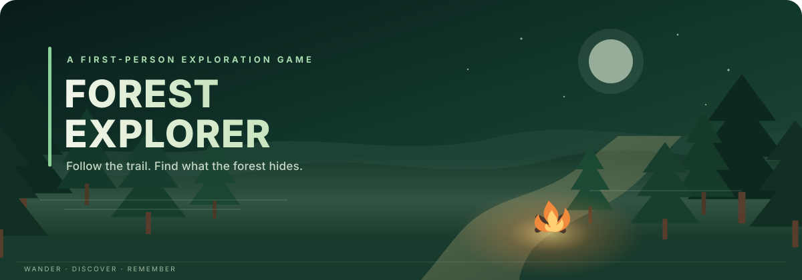

<p align="center">
  
</p>

<p align="center">
  <strong>A quiet, first-person journey through a living low-poly forest.</strong><br>
  Wander winding trails, watch the light change, listen to the forest, and record discoveries along the way.
</p>

<p align="center">
  
  
  
</p>

## Overview

**Forest Explorer** is a browser-based 3D exploration experience built around atmosphere, gentle movement, and environmental discovery. Its stylized forest features winding dirt paths, layered vegetation, a quiet pond, standing stones, and a campfire clearing. A changing sky and day–night cycle give familiar locations a different mood as the journey unfolds.

The project is delivered as a static web application. The Three.js runtime is bundled locally, so the game does not need a CDN, package installation, or build step to load its engine.

## Features

- **Procedural forest environment** — varied trees, ground cover, ferns, flowers, mushrooms, rocks, fallen logs, paths, and terrain.
- **Changing atmosphere** — animated sky, sun and moon, fog, lighting, shadows, wind, and a day–night cycle.
- **First-person exploration** — keyboard and mouse support on desktop, plus touch controls for mobile screens.
- **Ambient soundscape** — procedural wind, leaves, birds, night insects, water, campfire ambience, and movement sounds.
- **Field journal** — discover and record four locations: the campfire, pond, standing stones, and a ranger waystone.
- **Quick-access settings** — pause and resume, restart, sound controls, time-of-day controls, and shadow settings.
- **Mobile-aware rendering** — quality settings adapt to device characteristics, with a manual quality option available through the URL.
- **Self-contained dependencies** — Three.js r160 is included in `vendor/`; no external game assets are fetched at runtime.

## Controls

| Action | Desktop | Mobile |
| --- | --- | --- |
| Move | `W` `A` `S` `D` or arrow keys | Left virtual joystick |
| Run | Hold `Shift` | Hold **RUN** |
| Look around | Mouse movement or drag | Drag the gameplay view |
| Examine a discovery | `E` or on-screen button | On-screen **EXAMINE** button |
| Open field journal | `J` or journal button | Journal button |
| Pause / resume | `Esc` or pause button | Pause button |

## Run locally

Forest Explorer is a static web project and has no build step.

1. Download or clone the repository.
2. Serve the project directory with any static HTTP server.
3. Open the local address in a modern browser with WebGL enabled.

For example, with Python installed:

```bash
python3 -m http.server 8000
```

Then open <http://localhost:8000>.

Using a local server is the most reliable way to run the multi-file version because some browsers restrict JavaScript and stylesheet loading from `file://` URLs.

## Project structure

```text
forest-explorer/
├── index.html                    # Page structure and game interface
├── style.css                     # HUD, menus, overlays, and touch controls
├── assets/
│   └── forest-explorer-banner.svg # Project banner
├── js/
│   ├── main.js                   # Renderer, player, input, HUD, game loop
│   ├── world.js                  # Terrain, vegetation, props, collisions
│   ├── env.js                    # Sky, lighting, fog, day/night cycle
│   ├── audio.js                  # Ambient audio and footsteps
│   └── util.js                   # Shared math, geometry, noise, and wind helpers
├── vendor/
│   ├── three.min.js              # Three.js r160 runtime
│   └── THREE-LICENSE.txt         # Third-party license
└── backup/
    └── index.original.html       # Preserved original single-file version
```

## Compatibility

A modern browser with WebGL support is required. Desktop keyboard/mouse controls and mobile touch controls are provided; actual frame rate and audio behavior depend on the device and browser. On mobile, sound may begin only after the first user interaction due to browser autoplay policies.

The project can be hosted as a static site on services such as GitHub Pages or any compatible static web host. Keep the relative file structure intact when deploying.

## Third-party software

The project bundles **Three.js r160**, distributed under the MIT License. See [`vendor/THREE-LICENSE.txt`](vendor/THREE-LICENSE.txt) for its license text.

---

<p align="center"><sub>Forest Explorer · A small world made for taking the longer way around.</sub></p>
