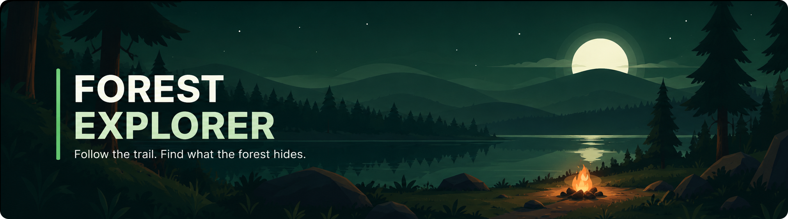

  

A quiet, first-person journey through a living forest. Wander winding trails, watch the light change, listen to the forest, and record discoveries along the way.

  

## Features

- **Living forest** — Explore winding paths, varied vegetation, a pond, standing stones, and a campfire clearing.
- **Changing atmosphere** — Watch the sky, lighting, fog, and time of day shift as you explore.
- **Explore at your own pace** — Walk or run around the environment and examine interesting locations.
- **Ambient soundscape** — Hear wind, leaves, birds, night insects, water, campfire ambience, and movement sounds.
- **Field journal** — Discover and record four locations around the forest.
- **Quick settings** — Pause, restart, adjust the time of day, and toggle sound or shadows.
- **Touch controls** — Use a virtual joystick and on-screen controls on mobile devices.

## Controls

| Action | Desktop | Mobile |
| --- | --- | --- |
| Move | `W` `A` `S` `D` or arrow keys | Left virtual joystick |
| Run | Hold `Shift` | Hold **RUN** |
| Look around | Mouse movement or drag | Drag the gameplay view |
| Examine a discovery | `E` or on-screen button | On-screen **EXAMINE** button |
| Open field journal | `J` or journal button | Journal button |
| Pause / resume | `Esc` or pause button | Pause button |

## Tech Stack

  

  

---

## Why Forest Explorer?

Forest Explorer is designed for a quieter kind of game: one focused on atmosphere, curiosity, and discovery rather than combat or score-chasing. The goal is to give players a small world to wander through, notice details, and explore at their own pace.

## How It Works

The browser loads the local game engine and JavaScript modules for the forest, environment, sound, and main game loop. Players explore with keyboard and mouse controls or mobile touch controls, and can record discoveries in the field journal. The project runs as a static web experience without a separate application backend.

  <strong>Forest Explorer</strong> 
  <em>Follow the trail. Find what the forest hides.</em> 
  Made by Johan Rohith

